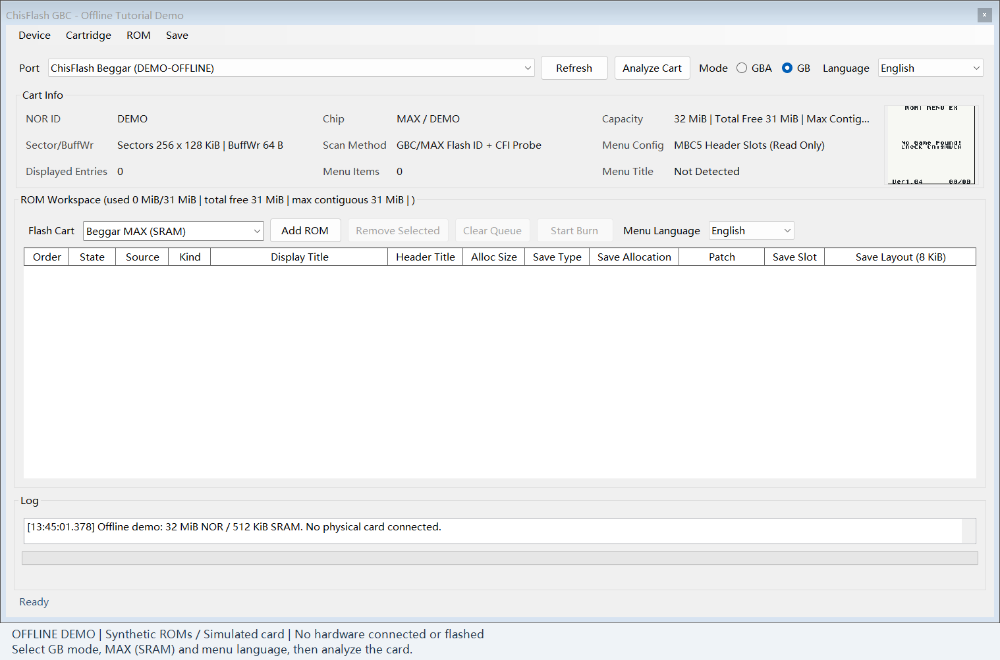
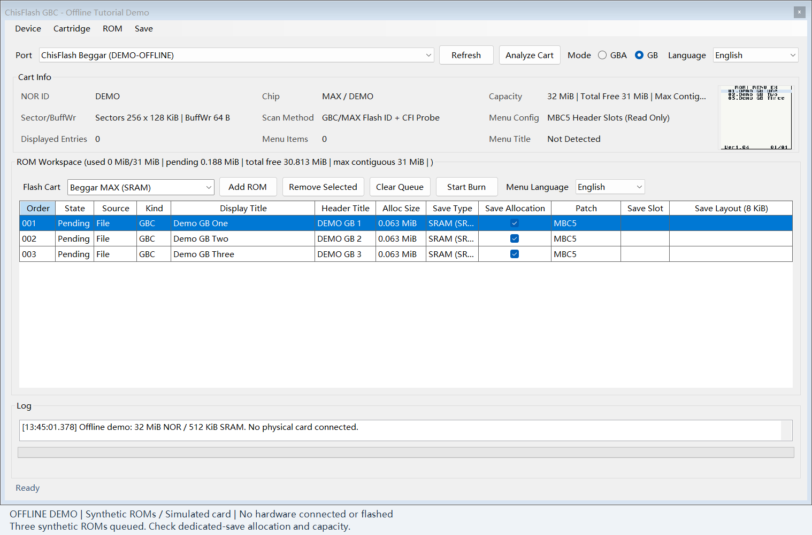
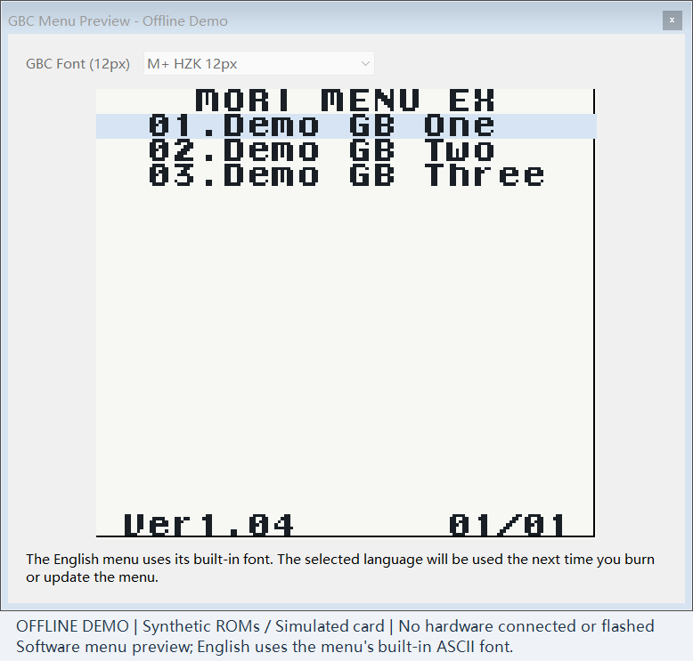
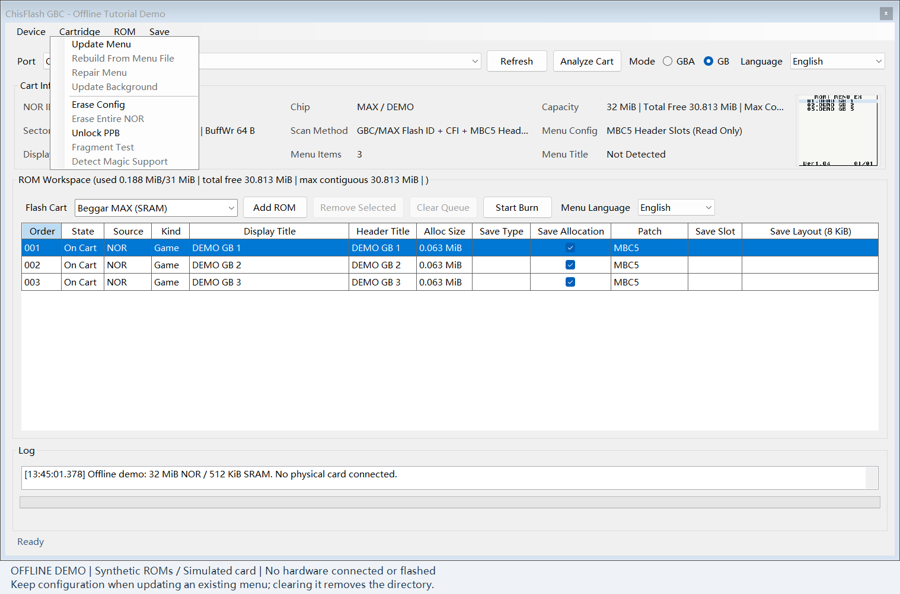
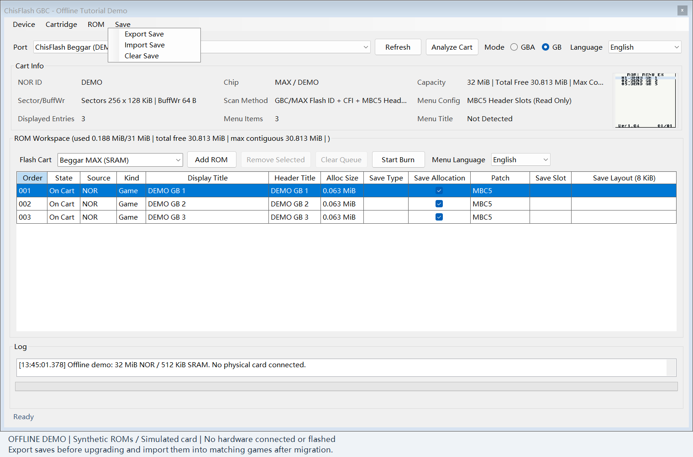
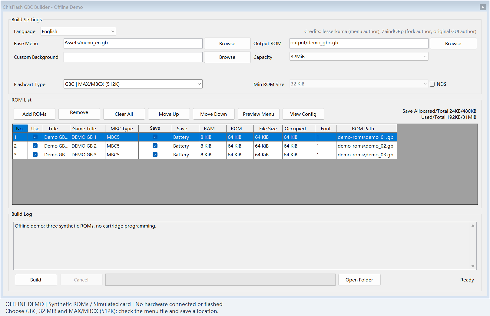
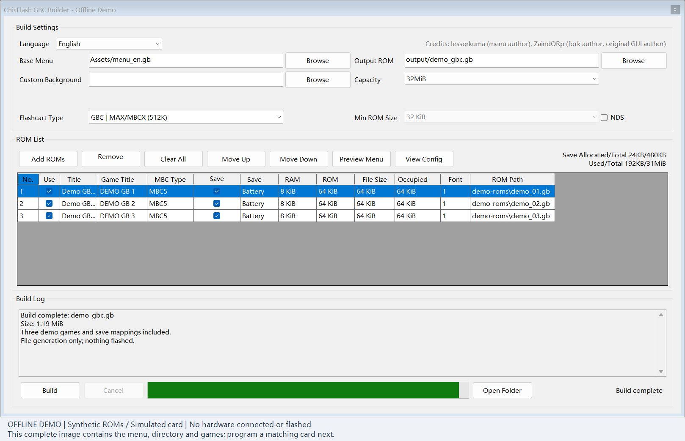

# GBC Free Multicart Operation Guide

**English** | [简体中文](TUTORIAL.zh-CN.md) | [FAQ: cards, saves and limitations](FAQ.en.md)

Choose one of two workflows for your programmer:

- **Beggar programmer: write directly with the Client.** Add games, configure the menu and write the cartridge in the Client; see sections 2 and 3.
- **Other compatible programmers, such as gbflash: generate a complete ROM with the Builder, then write the whole file.** The Builder combines the menu, directory and games into one complete multicart ROM. It does not program the cartridge itself; use your programmer to write the generated file in full. See section 4.

## 1. What You Need

Before making a multicart, prepare:

- A **programmer** and USB data cable: use the Client for direct writes with Beggar, or a complete Builder-generated ROM with another compatible programmer such as gbflash.
- A **cartridge already updated with Free Multicart firmware**: MBCX or MBC5 MAX 1.2 with 32 MiB NOR and 512 KiB SRAM.
- Your own **GB / GBC game ROMs** (`.gb` / `.gbc`).
- Your own **12px Chinese font** for the Chinese menu. The English menu needs no external font.

**This guide's fresh-multicart workflow starts with a full NOR chip erase, followed by installing the menu and writing new games.** The erase removes the existing menu, directory and game ROMs from NOR; export any ROMs and saves you want to keep first. This guide covers multicart operations only and assumes the cartridge's Free Multicart firmware is already updated.

## 2. Full NOR Erase and Fresh Multicart Setup with the Client

This section uses the Client with a Beggar programmer. For gbflash or another programmer, go directly to section 4. Section 3 is an optional workflow that retains existing games, not this fresh-multicart setup.

The GB full-erase action in this section requires Client **2.034 or a later version that includes this feature**. Client 2.031 does not include it. Offline regression checks and builds pass; physical-cartridge validation is still pending. Obtain the companion tools from the maintainer.

1. Select the port and `GB` mode, then click `Analyze Cart` to detect NOR and confirm 32 MiB capacity.
2. Select `Free multicart · MAX/MBCX 32M` under `Flash Cart`, then analyze the cartridge again. Older versions call this `Beggar MAX (SRAM)`; the screenshots below show the older interface. Select the free multicart mode appropriate to your version.
3. Select Chinese or English under `Menu Language`.

4. Use **`Cartridge > Erase Entire NOR`**, accept both confirmations, and wait for chip erase and full-capacity verification. Existing games, menus or a valid multicart directory are not prerequisites. This erases all NOR contents but not the separate SRAM save chip. Back up any saves you want to keep first.

> This erases the entire NOR chip, not just configuration or the game directory. If erase fails, times out or fails verification, check the connection and rescan before installing a menu or writing games.

5. Click `Analyze Cart` again, then use `Cartridge > Update Menu`. Choose **Yes** when asked to clear configuration to install a new multicart menu.
6. Click `Add ROM`, and check game order, dedicated-save selections and available space.

7. Click the menu preview at the top right. Chinese requires a 12px font: select your own and check the titles. English needs no external font.

8. Return to the main window and click `Start Burn`. Keep power and USB connected until completion.
9. Rescan, then test launching, saving and reloading after a power cycle.

## 3. Optional: Retain Games While Updating the Menu or Migrating Saves

This section does not perform a full chip erase. For a fresh multicart, follow section 2.

1. Export ROMs and saves, including the last-played game's latest save.
2. Use a matching Client version and confirm the cartridge already has the updated Free Multicart firmware.
3. Analyze the card, check the existing game list and select `Menu Language`.
4. Use `Cartridge > Update Menu`. **Choose No when asked to clear configuration** to retain existing games.

5. Check the list and saves afterwards. For an unrecognized / damaged directory or a layout change, export first and rebuild.
6. To move cards, install and burn games on the target first. Select each matching game and `Import Save` with the correct version's `.sav`. Keep the old card until verified.

## 4. Builder: Generate a Complete ROM for Another Programmer

This workflow is for other compatible programmers, such as gbflash. Build one complete ROM, use your programming tool to erase the entire cartridge NOR, then write the whole file. You do not need to follow the Client installation in section 2 first. Back up any ROMs and saves you want to keep.

1. Select `GBC`, 32 MiB and `GBC | MAX/MBCX (512K)`.
2. Select `menu_zh.gb` or `menu_en.gb` as `Base Menu`. Select your own 12px font for Chinese.
3. Add ROMs, arrange titles / order, and check dedicated-save allocation.
4. Set `Output ROM` and click `Build`.

5. Confirm success with no skipped games and locate the file specified by `Output ROM`. This is the **complete multicart ROM**, containing the menu, directory and games.

6. Follow your programmer's instructions to perform a **full cartridge NOR chip erase** and wait for completion. The tool must explicitly support a full chip erase for this cartridge.
7. Open this **complete multicart ROM** in the software for your programmer, such as gbflash. Follow its instructions to write the entire file from the start of the cartridge ROM. Do not write only the menu kernel or program the original game ROMs individually.
8. Use the programmer's verification function if available, then test the menu, game launching and saves on the console.

## 5. Launch Games on the Console

According to the maintainer's compatibility description, common **MBC1–MBC5 games** are supported. ROM information is detected automatically, and the corresponding MBC type is selected at launch. You can also select an MBC type manually before launching.

1. Select games with up / down; change pages with left / right.
2. Press `A` for details, then `A` again to launch.
3. Press `B` on the details page to return.
4. After saving completes, power-cycle and check the save.
