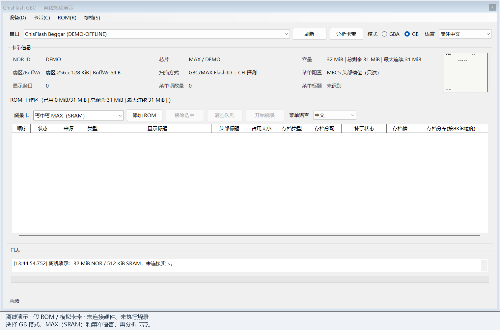
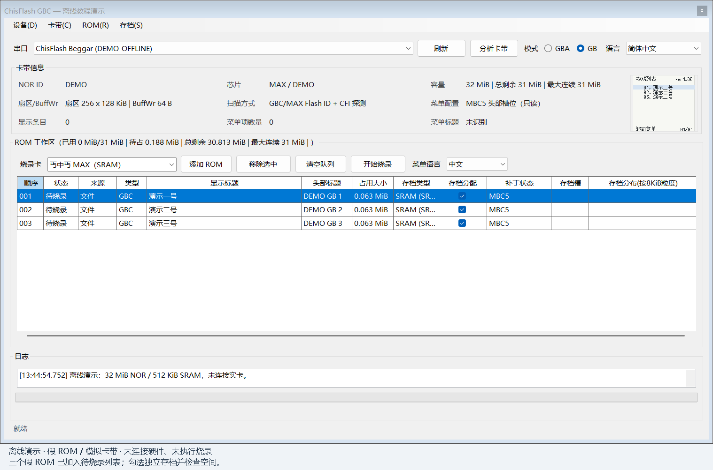
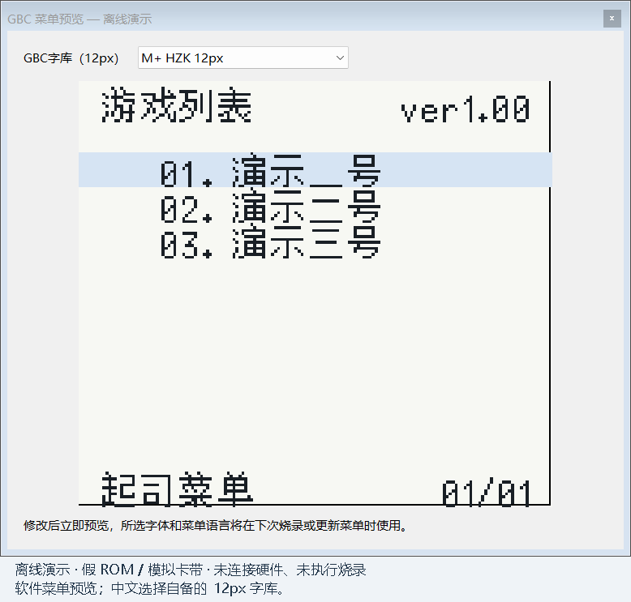
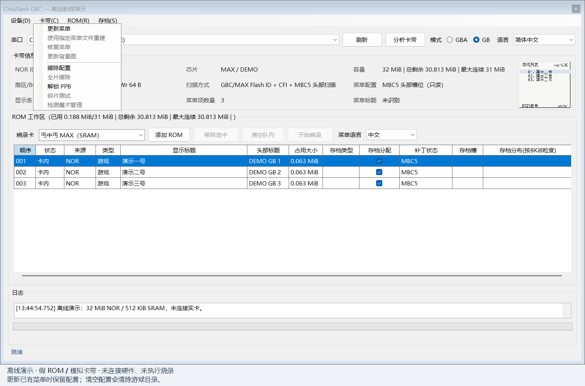
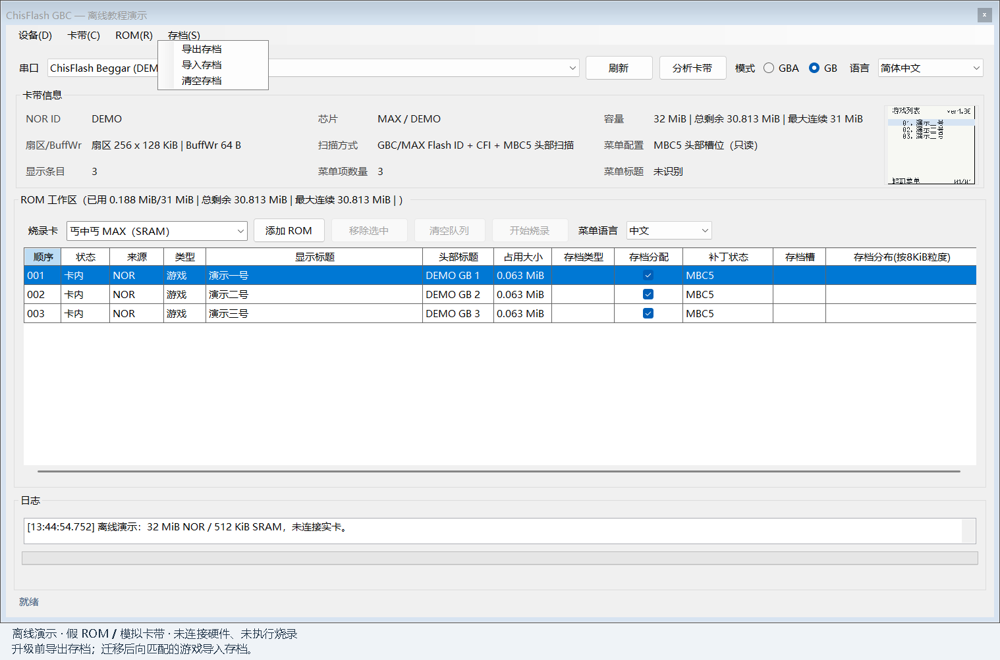
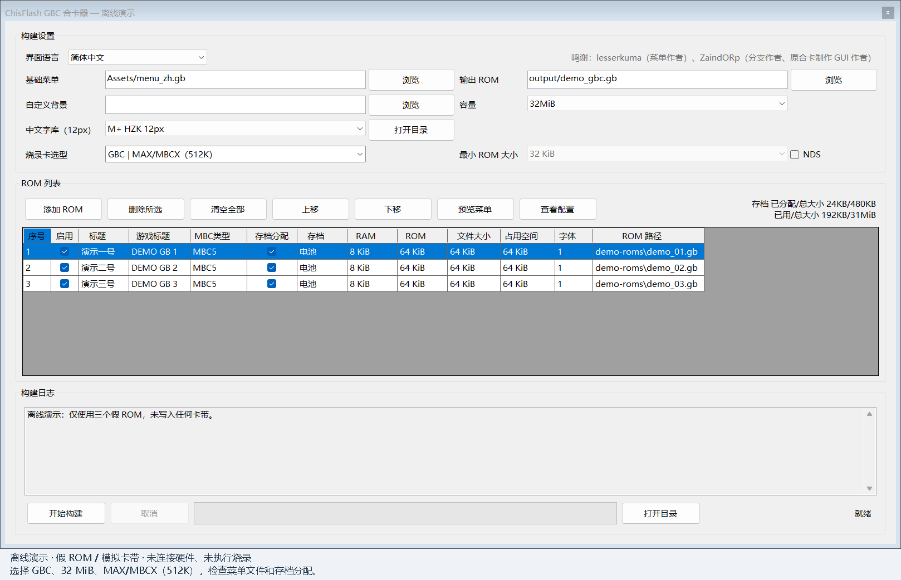
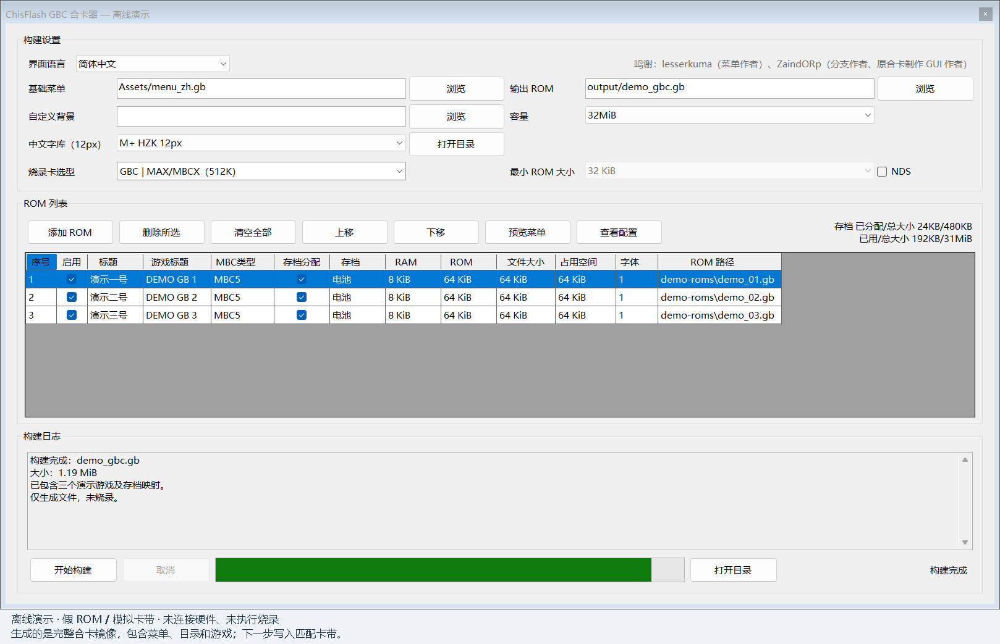

# GBC 自由合卡操作教程

**简体中文** | [English](TUTORIAL.en.md) | [QA：卡型、存档与限制](FAQ.zh-CN.md)

合卡有两种方式，按你的烧录器选择：

- **丐中丐烧录器：使用上位机直接烧录。** 在上位机中添加游戏、设置菜单并写入卡带，见第二、三节。
- **gbflash 等其他兼容烧录器：使用合卡器生成完整 ROM，再完整烧录。** 合卡器把菜单、目录和游戏合成一个完整的合卡 ROM 文件，本身不直接烧卡；生成后交给所用烧录器完整写入，见第四节。

## 1. 准备

开始合卡前，请准备：

- **烧录器**及 USB 数据线：丐中丐使用上位机直烧；gbflash 等其他兼容烧录器使用合卡器生成的完整 ROM。
- **已升级好自由合卡固件的卡带**：配备 32 MiB NOR、512 KiB SRAM 的 MBCX 或 MBC5 MAX 1.2。
- **自备的 GB / GBC 游戏 ROM**（`.gb` / `.gbc`）。
- 使用中文菜单时，准备 **12px 中文字库**；英文菜单无需额外字库。

**本教程按全新合卡处理：先全片擦除卡带 NOR，再安装菜单并烧录新的游戏。** 全片擦除会清除 NOR 内原有的菜单、目录和游戏 ROM；需要保留的 ROM 和存档请先导出。本教程只介绍合卡操作，默认卡带的自由合卡固件已经升级完成。

## 2. 全片擦除后全新合卡（上位机）

本节适用于上位机配合丐中丐烧录器。使用 gbflash 等其他烧录器时，直接看第四节。第三节的保留游戏更新属于可选流程，不是本节的全新合卡流程。

本节的 GB 全片擦除入口需使用上位机 **2.034 或后续包含此功能的版本**；2.031 不具备此功能。该功能已通过离线回归与编译，尚待实卡验证。配套工具可从 [工具集 Releases](https://github.com/ChisLightyear/ChisFlash-Tools-Exp/releases/tag/v2.046-r15-0.92.5) 下载。

1. 选择串口，模式设为 `GB`，点击 `分析卡带` 检测 NOR，确认容量为 32 MiB。
2. 在 `烧录卡` 中选择 `自由合卡 · MAX/MBCX 32M`，再分析卡带。旧版名称为 `丐中丐 MAX（SRAM）`；下方截图使用旧版界面，按所用版本对应选择自由合卡模式。
3. 在 `菜单语言` 中选择中文或英文。

4. 使用 **`卡带 → 全片擦除`**，确认两次提示，等待擦除与整片校验完成。卡内是否有游戏、菜单或有效合卡目录都不影响这项操作；会清除 NOR 内全部内容，但不会擦除独立的 SRAM 存档芯片。需要保留的存档仍请先备份。

> 这是整片 NOR 擦除，不是只清除配置区或游戏目录。擦除失败、超时或校验失败时，先检查连接并重新分析卡带，不要继续安装菜单或烧录。

5. 重新点击 `分析卡带`，然后使用 `卡带 → 更新菜单`。询问“是否清除配置区”时选 **“是”**，安装新的合卡菜单。
6. 点击 `添加 ROM`，检查游戏顺序、独立存档勾选和占用空间。

7. 点击右上角菜单预览。中文仅支持自备的 12px 字库，选择后检查标题是否完整；英文无需另备字库。

8. 返回主窗口，点击 `开始烧录`。写入期间不要断电或拔线。
9. 完成后重新扫描，上机测试启动、保存和重启读档。

## 3. 可选：保留游戏更新菜单或迁移存档（上位机）

本节不执行全片擦除；全新合卡请按第二节操作。

1. 导出 ROM 和存档，确认最后游玩的游戏已备份。
2. 使用配套版本的上位机，确认卡带已升级好自由合卡固件。
3. 分析卡带，核对原游戏列表，选择 `菜单语言`。
4. 点击 `卡带 → 更新菜单`。保留已有游戏时，**“是否清除配置区”选“否”**。

5. 更新后核对列表并测试存档。目录无法识别、损坏或需要换布局时，先导出，再按第二节流程重建。
6. 换卡时先在目标卡重新合卡、烧录游戏，再选中对应游戏，用 `导入存档` 恢复匹配版本的 `.sav`。确认正常前保留旧卡。

## 4. 合卡器：生成完整 ROM，供其他烧录器烧录

本节适用于 gbflash 等其他兼容烧录器。先用合卡器合成一份完整 ROM，再用所用烧录工具全片擦除卡带 NOR，最后把整份 ROM 完整写入卡带；不需要先走第二节的上位机安装流程。需要保留的 ROM 和存档请先备份。

1. 选择 `GBC`、32 MiB 和 `GBC | MAX/MBCX（512K）`。
2. `基础菜单` 选择 `menu_zh.gb` 或 `menu_en.gb`。中文另选自备的 12px 字库。
3. 添加 ROM，调整名称和顺序，检查独立存档分配。
4. 设置 `输出 ROM`，点击 `开始构建`。

5. 确认构建成功且没有跳过游戏，找到 `输出 ROM` 指定的文件。这是包含菜单、目录和游戏的**完整合卡 ROM**。

6. 按所用烧录器的操作说明，执行**卡带 NOR 全片擦除**，等待完成；所用工具必须明确支持这张卡带的整片擦除。
7. 在 gbflash 等所用烧录器的软件中选择这份**完整合卡 ROM**，按该烧录器的操作说明，将文件从卡带 ROM 起始位置完整写入。不要只烧菜单内核，也不要把原始游戏 ROM 逐个单独烧入。
8. 写入完成后使用烧录器的校验功能（如有），再上机检查菜单、游戏启动和存档。

## 5. 在掌机菜单中启动

按维护者提供的兼容性说明，当前兼容 **MBC1～MBC5 常见游戏**，自动识别 ROM 文件信息，并在启动时切换到对应的 MBC 类型。也可以自行选择 MBC 类型后启动。

1. 上下选游戏，左右翻页。
2. 按 `A` 查看详情，再按 `A` 启动。
3. 在详情页按 `B` 返回。
4. 保存完成后关机，再开机读档检查。
